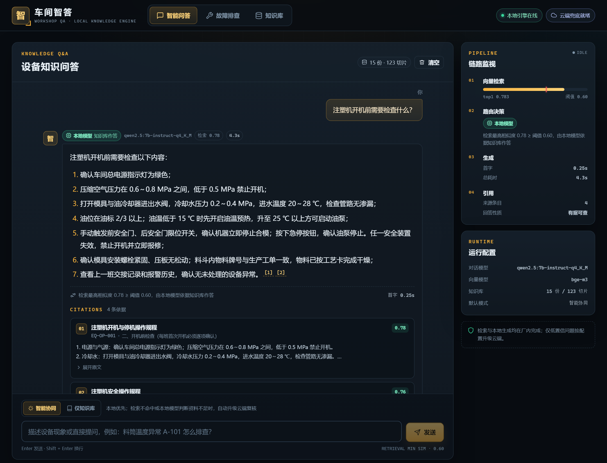

# 车间智答 · Workshop QA

面向智能制造一线的**本地化 AI 知识与故障排查助手**。

设备手册、点检标准、故障案例、安规规程进入知识库后，一线工人用自然语言提问，系统在工厂本地服务器上用 Qwen2.5 作答，**答案必须带出处**；资料不足时明确拒答，复杂或低置信问题按配置自动升级 DeepSeek 云端复核。

> 全国高校 AI Web 开发挑战赛（博学谷平台）参赛作品 · 2026-11-18 提交

**数据不出厂 · 离线可用 · 回答可溯源**



## 项目简介

车间里的知识散落在 PDF、纸质规程、老师傅经验里。新人遇到报警，常见的做法是翻手册、问师傅、在群里发消息；答案慢、口径不一致，而且一旦问到大模型，设备参数和工艺数据就出了厂。

「车间智答」把厂内文档做成一个可检索、可追溯的知识库：

- 问「注塑机开机前需要检查什么」，逐条列出检查项，句末 `[1][2]` 点开就是手册原文；
- 手册没写的问题，系统不会硬编，而是明确说「知识库中暂无相关记录」；
- 本地资料不足、但问题确实属于注塑领域时，自动切到 DeepSeek 补充通用工程建议，界面用蓝色标签标出「云端模型」和切换原因；
- 温度异常这类有固定排查路径的故障，走一遍状态机向导，每步给出手册依据，最后生成可打印的 A4 处置单。

## 作品链接

| 项目 | 地址 / 状态 |
| --- | --- |
| 开源仓库 | <https://github.com/rqy18723992791-afk/workshop-qa> |
| 在线演示 | 待部署（服务器信息到位后补公网地址；无需登录） |
| 演示视频 | 待录制（5–8 分钟，≥1080p；链接录制后补） |
| 技术文档 | [车间智答-技术文档.pdf](车间智答-技术文档.pdf)（仓库根目录，≤30 页） |
| 设计说明 | [docs/index.md](docs/index.md)（答辩复习材料） |

**仓库权限说明**：本仓库为公开仓库，评审可直接克隆、浏览和运行，无需申请权限或提供测试账号；代码以 [MIT License](LICENSE) 开源。

## 亮点

| 亮点 | 说明 |
| --- | --- |
| 本地优先，数据不出厂 | 检索、生成、诊断全部在本机 Ollama 完成；只有低置信问题按配置上云，且只发送问题与必要片段 |
| 回答可溯源 | 每个片段带文档名、编号、章节路径和相似度；引用编号与后端 `sources.index` 同源，不做字符串猜测 |
| 两层拒答 | 检索层 0.6 阈值挡住无关问题，生成层再判断「资料是否足够」；拒答时来源置空，不列假出处 |
| 端云协同路由 | 本地拒答或检索不命中时自动升级 DeepSeek，SSE `route` 事件让界面实时切换标签与原因 |
| 确定性诊断工作流 | 12 节点 / 11 结论的状态机，每步带手册依据、可回退，输出结构化处置单并支持 A4 打印与 Markdown 导出 |
| MCP 工具化 | 知识库检索封装为 `search_knowledge` / `list_documents` 两个 MCP 工具，标准客户端实测可调用 |
| 工业风前端 | 无 UI 框架，自建设计令牌；深色高对比、状态色明确、移动端可用，390×844 实测无横向溢出 |
| 阈值有据可查 | 30 条问句校准出 0.6，记录正向/负向/灰区分组与过拟合修正过程，可一键复现 |

## 功能与验收状态

| 功能 | 状态 | 验收证据 |
| --- | --- | --- |
| 知识库导入、管理、重建索引 | ✅ | 15 份文档 / 123 切片，管理页可增删查 |
| RAG 流式问答 + 引用卡片 | ✅ | 本地问题 top-1 0.7833，答案与 `EQ-OP-001` 原文一致 |
| 无依据拒答 | ✅ | 无关问题 0.4242 < 0.6，`refused=true`，来源为空 |
| 故障排查向导 + 处置单 | ✅ | 6 步走完，结论「SSR 损坏」，A4 PDF 无裁切 |
| 端云协同路由 | ✅ | 本地 0.7833 不上云；0.6589 本地拒答后切 `deepseek-chat` |
| MCP 工具 | ✅ | 官方客户端 `list_tools` + 调用成功，`max_score=0.8078` |
| 部署脚本与文档 | ✅ 本地生产态 | 单端口 8000 跑通三视图与 SSE；公网待服务器信息 |
| 技术文档 / 视频脚本 | ✅ 初稿 | PDF 在仓库根目录；脚本见 [docs/video-script.md](docs/video-script.md) |

逐项验收记录与原始 JSON：[docs/acceptance.md](docs/acceptance.md)。

## 技术栈

| 层 | 技术 |
| --- | --- |
| 前端 | Vue 3 `<script setup>` + Vite + TypeScript strict；无 UI 框架，自建 CSS 设计令牌；marked + DOMPurify |
| 后端 | Python FastAPI；只做 AI 接入层（文档处理、检索、模型调用、路由），不做用户系统 |
| 本地模型 | Ollama：`qwen2.5:7b-instruct-q4_K_M`（生成）+ `bge-m3`（1024 维向量） |
| 向量库 | Chroma 本地持久化，余弦距离，`score = 1 - distance` |
| 云端兜底 | DeepSeek API（OpenAI 兼容），`deepseek-chat` |
| 协议 | SSE 流式；MCP Python SDK v2（stdio） |
| 部署 | Ubuntu 22.04/24.04 + systemd + Nginx 反代（关闭缓冲），FastAPI 托管前端构建产物 |

## 架构

```
浏览器（Vue 3 单页应用）
  │  POST /api/chat/stream（SSE）
  ▼
FastAPI ──► 检索（bge-m3 + Chroma top-4）
  │            │
  │      max_score ≥ 0.6 ?
  │        │          │
  │       是          否
  │        ▼          ▼
  │   Qwen2.5-7B   route_mode=auto ? ──是──► DeepSeek 云端
  │        │          │                        │
  │   拒答语? ──是────┘                        │
  │        │                                   │
  │        └────────── route 事件切换 ─────────┘
  ▼
meta（来源/分数/路由）→ delta（正文）→ done（完整答案）
```

诊断向导是另一条确定性链路：`状态机节点 → 用户选择 → 下一节点/结论 → 处置单`，不经过大模型自由生成。

## 目录结构

```
├── README.md                   # 项目说明
├── LICENSE                     # MIT 开源协议
├── 车间智答-技术文档.pdf        # 技术文档（≤30 页）
├── .env.example                # 环境变量模板（复制为 backend/.env）
├── backend/
│   ├── app/
│   │   ├── main.py             # FastAPI 入口、静态前端托管
│   │   ├── config.py           # 环境变量与路径
│   │   ├── routers/            # kb / chat / diag 三组 API
│   │   └── services/           # 切分、向量化、检索、生成、路由、诊断
│   ├── mcp_server.py           # MCP Server（stdio）
│   ├── scripts/                # 校准、验收脚本
│   └── requirements.txt
├── frontend/
│   └── src/
│       ├── App.vue             # 外壳：导航、状态灯、KeepAlive
│       ├── components/         # ChatView / DiagnosisView / KnowledgeView / SourceCard ...
│       ├── lib/                # API 封装、SSE 解析、类型
│       └── style.css           # 工业风设计令牌
├── data/docs/                  # 15 份示例知识库文档
├── deploy/                     # setup.sh / deploy.sh / systemd / nginx / 部署说明
└── docs/                       # 设计说明、校准数据、验收证据、视频脚本
```

## 快速开始

### 0. 环境要求

- Python 3.11+，Node.js 18+（推荐 20）
- [Ollama](https://ollama.com/download)，建议 8 GB+ 显存；纯 CPU 也能跑，首字会慢
- 可选：DeepSeek API Key（不填则云端不可用，界面显示「云端未配置」）

### 1. 拉取本地模型

```bash
ollama pull qwen2.5:7b-instruct-q4_K_M
ollama pull bge-m3
```

### 2. 启动后端

```bash
cd backend
python -m venv .venv
# Windows: .venv\Scripts\activate    Linux/macOS: source .venv/bin/activate
pip install -r requirements.txt

# 复制根目录 .env.example 为 backend/.env，按需填写 DEEPSEEK_API_KEY
# Windows: copy ..\.env.example .env    Linux/macOS: cp ../.env.example .env

python -m uvicorn app.main:app --host 127.0.0.1 --port 8000
```

### 3. 启动前端

```bash
cd frontend
npm ci
npm run dev        # http://localhost:5173，/api 与 /health 已代理到 8000
```

生产态（单端口）：

```bash
cd frontend && npm run build
cd ../backend && python -m uvicorn app.main:app --host 127.0.0.1 --port 8000
# 打开 http://127.0.0.1:8000/
```

### 4. 导入知识库

```bash
curl -X POST http://127.0.0.1:8000/api/kb/import
curl http://127.0.0.1:8000/api/kb/documents
```

首次导入会调用 bge-m3 向量化 123 个切片，约 10–30 秒；之后检索为毫秒级。

### 5. 试一遍

1. 问「注塑机开机前需要检查什么？」→ 本地答案 + 引用卡片；
2. 问「如何做红烧肉？」→ 明确拒答；
3. 问「注塑机螺杆磨损到什么程度必须更换？」→ 本地拒答后自动切云端，标签变蓝；
4. 进「故障排查」→ 开始诊断 → 按提示选择，走完生成处置单 → 打印 / 下载 Markdown；
5. 进「知识库」→ 检索测试台，现场改问题看相似度与阈值。

## API 一览

| 方法 | 路径 | 说明 |
| --- | --- | --- |
| GET | `/health` | 健康检查：模型、阈值、路由模式、前端是否已构建 |
| POST | `/api/kb/import?rebuild=false` | 扫描 `data/docs` 增量导入；`rebuild=true` 全量重建 |
| POST | `/api/kb/reindex` | 清空索引并全量重建 |
| POST | `/api/kb/upload` | 上传 `.md`/`.txt`（multipart），保存并入库 |
| GET | `/api/kb/documents` | 文档清单（编号、类别、版本、切片数） |
| DELETE | `/api/kb/documents/{doc_id}` | 删除索引，源文件移入 `data/docs/.trash` |
| POST | `/api/kb/search` | 向量检索：片段、相似度、`has_relevant` |
| POST | `/api/chat` | RAG 问答（非流式）：答案、路由、引用、是否拒答 |
| POST | `/api/chat/stream` | RAG 问答（SSE）：`meta → route? → delta → done/error` |
| GET | `/api/diag/topics` | 可用诊断主题 |
| POST | `/api/diag/sessions` | 开始一次诊断 |
| GET | `/api/diag/sessions/{id}` | 查看会话当前状态 |
| POST | `/api/diag/sessions/{id}/answer` | 提交当前步骤选择 |
| POST | `/api/diag/sessions/{id}/back` | 回退一步 |
| GET | `/api/diag/sessions/{id}/report` | 结构化处置单 |
| GET | `/api/diag/sessions/{id}/report.md` | Markdown 处置单下载 |

MCP 客户端配置见 [docs/mcp.md](docs/mcp.md)：

```json
{
  "mcpServers": {
    "workshop-qa": {
      "command": "<repo>/backend/.venv/bin/python",
      "args": ["<repo>/backend/mcp_server.py"]
    }
  }
}
```

## 测试与验收

```bash
# 30 条问句阈值校准（需后端与 Ollama 运行）
backend/.venv/Scripts/python.exe backend/scripts/calibrate.py

# 路由三路径 + 诊断链路验收，写入 docs/evidence/
backend/.venv/Scripts/python.exe backend/scripts/acceptance_routes.py

# MCP 客户端验收
backend/.venv/Scripts/python.exe backend/scripts/test_mcp_client.py
```

实测结果与原始数据：

- 本地路径：top-1 0.7833，首字约 1.0 s，引用 `EQ-OP-001` / `EQ-OP-003` / `PM-D-001`；
- 云端升级：top-1 0.6589，本地拒答后 `route→cloud`，模型 `deepseek-chat`；
- 拒答：0.4242 < 0.6，`refused=true`，`sources=[]`；
- 诊断：6 步，报告 `CZ-20261105-070AF4`，结论「固态继电器（SSR）损坏，需更换」；
- MCP：`has_relevant=true`，`max_score=0.8078`，15 份文档。

详见 [docs/acceptance.md](docs/acceptance.md) 与 [docs/evidence/](docs/evidence/)。

## 部署

本地生产态已验证；公网部署物料在 [deploy/](deploy/)：

```bash
sudo bash deploy/setup.sh     # 首次：装依赖、建用户、构建前端、装 systemd + Nginx
sudo bash deploy/deploy.sh    # 更新：git pull、重建、重启、健康检查
```

完整步骤（Ollama、密钥、HTTPS、自测清单、故障排查）见 [deploy/README.md](deploy/README.md) 与 [docs/deployment.md](docs/deployment.md)。

## 安全约定

- 所有密钥只走 `backend/.env`（`.gitignore` 已排除）；仓库只保留 `.env.example`，代码中不出现任何 Key；
- `.env` 部署时 `chmod 600`，属主为运行用户；
- 上传只接受 `.md`/`.txt`，文件名去路径防目录穿越；删除文档移入 `.trash`；
- 云端只发送「问题 + 必要片段」，不上传整库；`ROUTE_MODE=kb_only` 可完全禁用云端；
- 提交前自查：无真实密钥、无真实个人数据。

## 文档索引

| 文档 | 内容 |
| --- | --- |
| [docs/handover.md](docs/handover.md) | 交接文档：环境启动、目录地图、已知坑与待办 |
| [docs/index.md](docs/index.md) | 设计说明总索引 |
| [docs/chunking.md](docs/chunking.md) | 切分与入库：标题栈、600 字、80 字重叠 |
| [docs/retrieval.md](docs/retrieval.md) | 向量检索、30 条校准、0.6 阈值怎么定 |
| [docs/rag-generation.md](docs/rag-generation.md) | 参考资料拼装、两层拒答、SSE 协议 |
| [docs/routing.md](docs/routing.md) | 端云决策树、拒答缓冲、云端提示词边界 |
| [docs/diagnosis.md](docs/diagnosis.md) | 诊断状态机、会话生命周期、处置单 |
| [docs/mcp.md](docs/mcp.md) | MCP Server 工具与客户端实测 |
| [docs/frontend.md](docs/frontend.md) | 设计令牌、SSE 消费、引用联动、打印 |
| [docs/deployment.md](docs/deployment.md) | 部署形态、systemd、Nginx SSE、安全清单 |
| [docs/calibration.md](docs/calibration.md) | 阈值校准记录 |
| [docs/video-script.md](docs/video-script.md) | 5–8 分钟演示视频脚本 |
| [docs/acceptance.md](docs/acceptance.md) | 逐项验收结果与证据 |

## AI 生成代码说明

本项目在开发过程中使用了 AI 编程助手（Claude Code）辅助生成代码、示例文档与文档初稿。所有 AI 生成内容均经人工审查、实际运行与验收；具体到模块的生成/人工修改比例、使用工具与责任声明，见技术文档附录 A。示例知识库文档为围绕注塑机自编的演示数据，数值为行业常识范围内的合理值，不来自任何真实工厂。

## License

[MIT](LICENSE) © 2026 车间智答团队
